# EmoDent Web

> **RESEARCH PROTOTYPE NOTICE & CLINICAL DISCLAIMER**  
> **EmoDent Web is a research prototype and a passive monitoring adjunct. It is NOT a diagnostic tool, medical device, or clinical decision support system.** It is not certified by FDA, CE-MDR, or any health authority. It must NOT be used to guide anesthesia dosage, pain relief, or clinical interventions. Any use in clinical settings requires prior Institutional Review Board (IRB) / Ethics Committee approval and informed parental consent and child assent.

---

## 1. Project Overview

**EmoDent Web** is a privacy-first, on-device browser application designed to explore real-time facial expression tracking and emotion monitoring in pediatric dental patients.

Dental procedures often induce high anxiety and distress in children who may have difficulty articulating discomfort. EmoDent Web tracks facial features continuously in real-time, categorizes expressions into 5 classes (`happy`, `neutral`, `angry`, `sad`, `fear`), logs structured procedural phases, and exports timestamped data for post-hoc validation against standardized clinician scales (e.g., **VCAS** - Venham Clinical Anxiety Scale and **VFAS** - Visual Facial Anxiety Scale).

### Key Architectural Pillars
- **100% Client-Side Privacy**: All processing (face tracking, cropping, inference, logging) happens entirely in the browser using WebAssembly and WebGL/WebGPU. No video, images, or biometric telemetry leave the device.
- **Zero-Latency In-Browser Architecture**: Utilizes MediaPipe Face Landmarker in `VIDEO` mode with off-main-thread ONNX Runtime Web Worker inference. Drops late frames without queue buildup to guarantee responsive 30 fps UI feedback.
- **Occlusion & Motion-Aware Quality Gate**: Dental procedures introduce suction tubes, gloved fingers, mirrors, and sudden head movements. A pure-function quality gate filters out degraded frames before running CNN inference.
- **Multi-Modal Distress Indicators**: Combines deep CNN emotion classification with a real-time facial blendshape-derived distress heuristic (`browDown`, `eyeSquint`, `mouthFrown`, `jawOpen`).

---

## 2. Real-Time Pipeline Architecture

```mermaid
flowchart TD
    subgraph BrowserClient["Browser Client (100% On-Device)"]
        A["Webcam / Dev Video Stream<br/>(30 FPS, requestVideoFrameCallback)"] --> B["MediaPipe Face Landmarker<br/>(478 landmarks + 52 blendshapes)"]
        
        B --> C{"Quality Gate Check"}
        C -- "No Face / Low Confidence /<br/>BBox < 64px / Rapid Motion" --> C1["Emit State: NO_RESULT<br/>(Skip Inference)"]
        
        C -- "Valid Face Geometry" --> D["Face Crop with 15% Margin<br/>Grayscale -> 48x48 -> Normalize"]
        
        D --> E["Off-Main-Thread Web Worker<br/>(ONNX Runtime Web: WebGL / WebGPU / WASM)"]
        
        E --> F["5-Way Softmax Probabilities<br/>[angry, fear, happy, neutral, sad]"]
        
        F --> G{"Confidence Filter<br/>(Top Prob >= 0.90?)"}
        G -- "No" --> G1["Emit State: UNCERTAIN"]
        G -- "Yes" --> H["Emotion Label"]
        
        G1 --> I["Rolling Majority Smoother<br/>(Window N = 15 frames)"]
        H --> I
        C1 --> I
        
        B -. "Blendshapes" .-> J["Experimental Blendshape<br/>Distress Heuristic"]
        
        I --> K["Live Video Overlay & Canvas UI<br/>(Label, Emoji, Confidence, Mesh)"]
        J --> L["Live Dashboard<br/>(Distress Gauge, Negative Affect, Rates)"]
        
        K --> M["Zustand Session Store<br/>(PRE_TREATMENT -> ANESTHESIA -><br/>EXTRACTION -> POST_TREATMENT)"]
        L --> M
        
        M --> N["Session Logger<br/>(Frame-level in-memory buffer)"]
        N --> O["Client-Side Exporter<br/>(CSV + JSON Summaries)"]
    end
```



---

## 3. Procedural Phases & Clinical Workflow

Clinicians choose up to **4 procedural phases** from a standardized dental catalog before initiating the session:
- **A. Pre-Treatment**: Baseline acclimation, settling, and seating.
- **B. Pulpectomy**: Pulp extirpation, root canal access, and instrumentation.
- **C. Crown Prep**: Occlusal and circumferential tooth reduction.
- **D. Caries Excavation**: Rotary or hand removal of carious dentin.
- **E. Extraction**: Luxation, elevation, and tooth removal.
- **F. Local Anesthesia**: Topical gel application and dental infiltration / block.

Operators can transition phases in real time using glove-friendly touchscreen tabs or physical keyboard shortcuts (`Keys 1–4`).

---

## 4. Clinician Comparator Scales & Blinded Mode

EmoDent Web supports three standardized clinician-rated comparators:
1. **Venham Clinical Anxiety Scale (VCAS: 0–4)**:
   - Evaluates overt physiological and behavioral distress from `0: Relaxed` to `4: Out of Control`.
2. **Visual Facial Anxiety Scale (VFAS: 0–4)**:
   - Validated pictorial facial schematic from `Face 0: Calm/Happy` to `Face 4: Extreme Panic`.
3. **Frankl Behavior Rating Scale (FBRS: 1–4)**:
   - Measures overt cooperative compliance from `1: Definitely negative (--)`, `2: Negative (-)`, `3: Positive (+)`, to `4: Definitely positive (++)`.
   - Reverse-oriented relative to VCAS/VFAS (lower score indicates worse behavior).
   - Clinical threshold: $\text{FBRS} \le 2$ defines negative behavior present.
   - For statistical comparisons, the analysis pipeline evaluates reversed FBRS: $\text{Reversed FBRS} = 5 - \text{FBRS}$.

### Blinded Rater Mode & Strict Data Separation
- Clinicians can toggle **"Blinded Rater Mode"** to enter ratings without seeing any live emotion badges, confidence levels, or AI overlays.
- AI frame records (`emodent_<participant>_frames.csv`) and clinician evaluations (`clinician_scores.csv`) are maintained in separate data files, joined only by `participant_id` and `phase`, preventing any data cross-contamination.

---

## 5. Clinical Dental Posture Overrides

Pediatric dental procedures inherently require children to hold their mouths open or display teeth during mirror checks, handpiece drilling, suction, and rubber dam placement:
- **Mouth Wide Open $\to$ Neutral**: When the patient opens their mouth wide (saying "ahhh" or during operative access), the system explicitly classifies the frame as `NEUTRAL` (unless an active smile AU12 is detected).
- **Mouth Slightly Open / Showing Teeth $\to$ Neutral**: Suppresses false-positive `ANGRY` classifications caused by dental mirror retraction and oral inspection.

---

## 4. Repository Structure

```text
.
├── ml/                     # Model training, evaluation, and ONNX export
│   ├── dataset.py          # FER-2013 loader, 5-class remap, augmentation, class weights
│   ├── model.py            # Compact 4-block CNN architecture (< 5 MB)
│   ├── train.py            # Training script with class-weighted cross entropy
│   ├── evaluate.py         # Test evaluation, precision/recall/F1, confusion matrix
│   ├── export_onnx.py      # ONNX exporter and numerical consistency verifier
│   ├── fine_tune.py        # Pediatric transfer learning template
│   └── README.md           # Dataset and ML documentation
├── web/                    # Browser frontend application
│   ├── public/
│   │   └── models/         # Exported ONNX model & MediaPipe assets
│   ├── src/
│   │   ├── components/     # UI widgets: VideoFeed, Dashboard, PhaseControl, etc.
│   │   ├── services/       # CameraService, FaceTracker, QualityGate, Exporter, etc.
│   │   ├── store/          # Zustand session state machine
│   │   ├── workers/        # Dedicated emotion inference Web Worker
│   │   └── tests/          # Vitest unit tests (QualityGate, Smoother, StateMachine)
│   ├── package.json
│   └── vite.config.ts
├── analysis/               # Statistical validation against clinician scales
│   ├── generate_synthetic_data.py # Synthetic session & clinician rating generator
│   ├── metrics.py          # Agreement (Kappa, PABAK, AC1), Friedman, Spearman
│   ├── analyze.py          # Full statistical analysis pipeline & plot generator
│   └── test_analysis.py    # Pytest validation of statistical formulas
├── data/
│   └── fer2013/            # FER-2013 dataset (train and test subfolders)
├── LIMITATIONS.md          # Comprehensive clinical & demographic limitations
└── README.md               # System documentation & quickstart
```

---

## 5. Getting Started

### Prerequisites
- Node.js >= 18.x and npm
- Python >= 3.10 with PyTorch, ONNX, and statistical libraries

### 1. Model Training & Export (/ml)
To train the compact CNN on FER-2013 (5-class remap) and export to ONNX:
```bash
python ml/train.py --epochs 25 --batch-size 64
python ml/evaluate.py
python ml/export_onnx.py
```
This automatically produces `web/public/models/emodent_cnn.onnx` (< 5 MB).

### 2. Running Web Application (/web)
```bash
cd web
npm.cmd install
npm.cmd run dev
```
Open `http://localhost:5173` in a modern browser (Chrome, Edge, or Safari).

### 3. Deploying to Static Hosting (Vercel, Netlify, Cloudflare Pages, GitHub Pages)
Because EmoDent Web runs 100% client-side with no backend API, it can be deployed to any static web hosting provider:
```bash
cd web
npm.cmd run build
```
This outputs production assets to `web/dist/`.

#### Critical Static Server Headers:
For high-performance WebAssembly multithreading and ONNX Runtime WebGL acceleration, the hosting server must serve these cross-origin isolation headers:
- `Cross-Origin-Opener-Policy: same-origin`
- `Cross-Origin-Embedder-Policy: require-corp` (or `credentialless`)

*Vercel / Netlify Configuration*:
These headers are already pre-configured in `web/vite.config.ts` for local development. For Vercel or Netlify deployments, add a `vercel.json` or `_headers` file with these response headers.

### 4. Running Analysis & Validation (/analysis)
To validate statistical agreement between AI predictions and clinician scores (VCAS/VFAS):
```bash
# Generate synthetic dataset for end-to-end validation
python analysis/generate_synthetic_data.py --participants 30

# Run agreement analysis, Friedman test, and generate plots
python analysis/analyze.py --data-dir analysis/sample_data
```

---

## 6. Real-Time Performance & Safety Controls
- **Dynamic Frame Dropping**: Inference requests pass over a non-blocking `postMessage` channel. If the worker is busy processing a frame, subsequent video frames are dropped rather than buffered.
- **Garbage Collection (GC) Conservation**: Pixel arrays, landmark buffers, and canvas drawing contexts are allocated once and reused across frames.
- **Blendshape Heuristic Warning**: The blendshape distress gauge is an unvalidated experimental heuristic combining facial muscle activations (`AU4`, `AU9/AU10`, `AU15`, `AU25/27`) and is not equivalent to a validated clinical pain scale.

